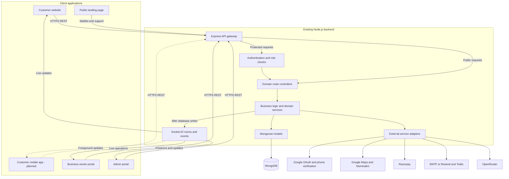
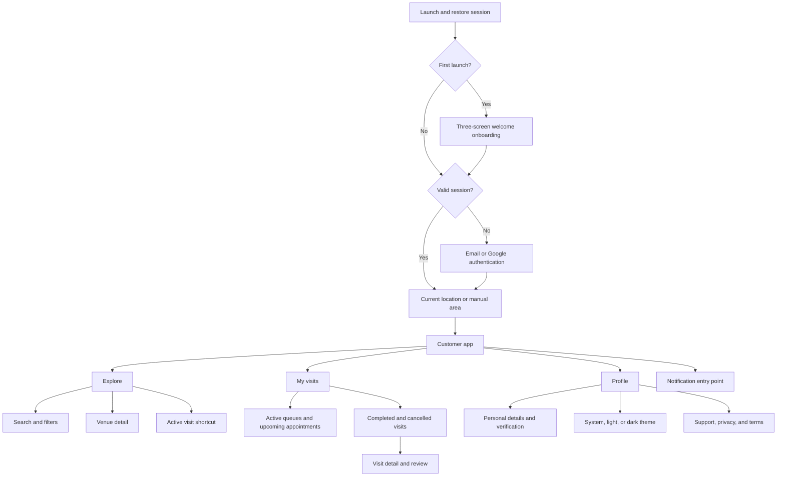
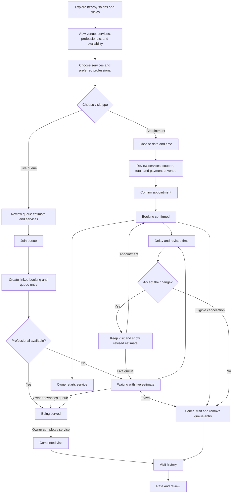
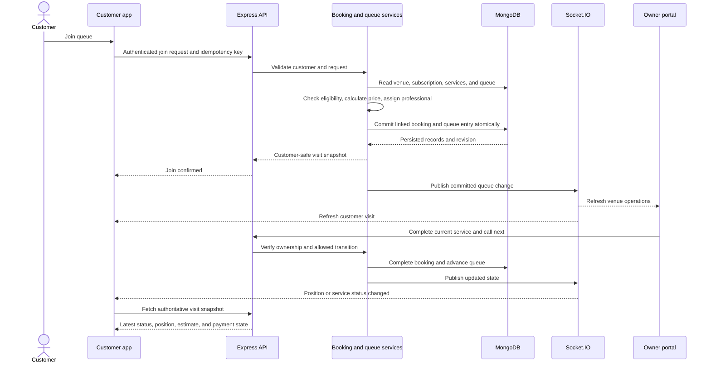
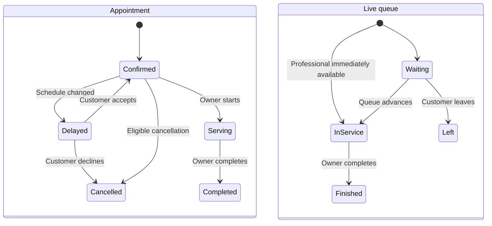
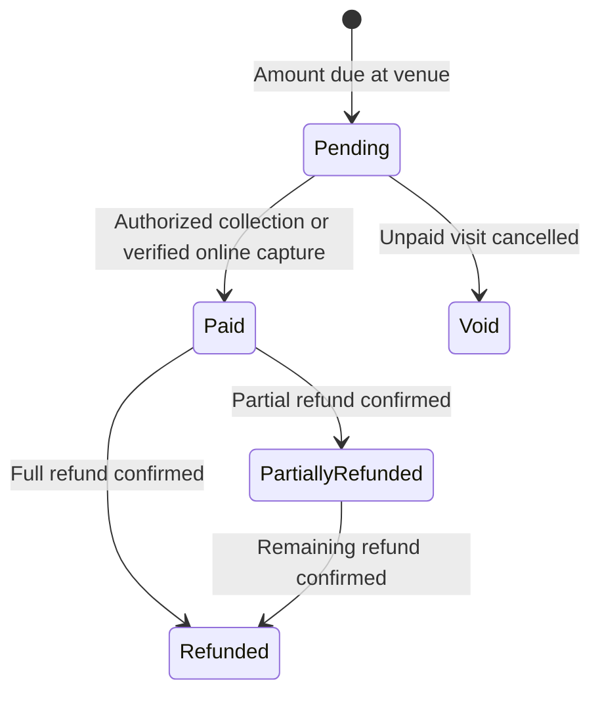
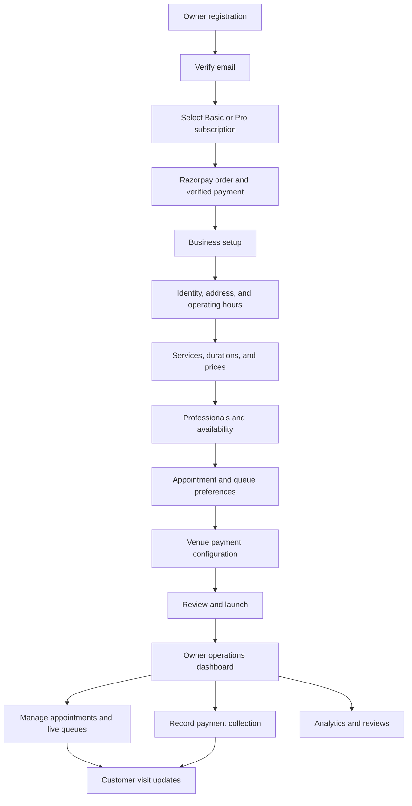
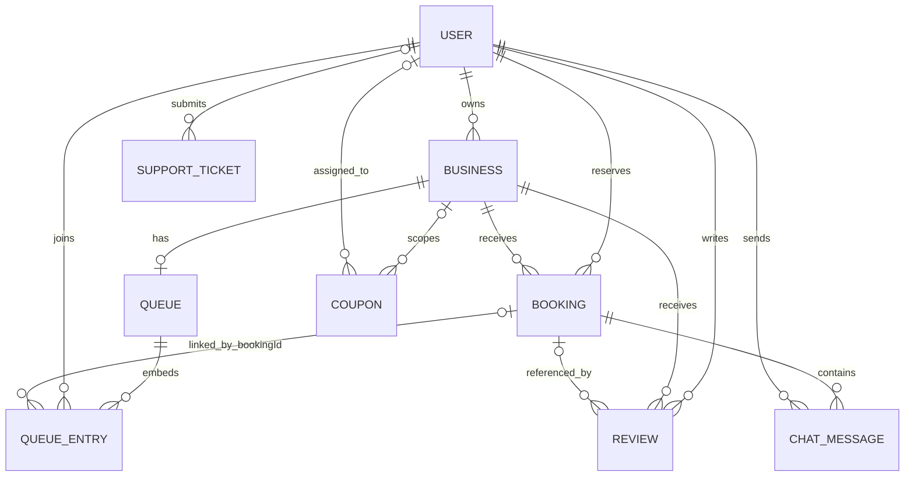
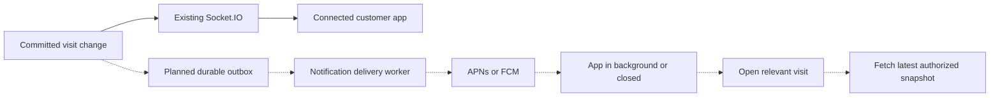
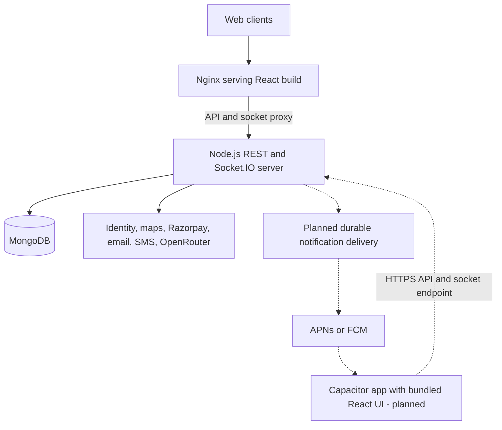

# ServeQ: workflow and architecture design

This document connects the existing repository to the proposed customer mobile app. **Existing** describes code that is present; it does not certify that every path is correct or production ready. **Planned** describes the mobile design and supporting changes that still need implementation. Dashed connections indicate planned components.

Rendered diagrams:

- Customer workflow: [PNG](diagrams/serveq-customer-workflow.png) · [editable SVG](diagrams/serveq-customer-workflow.svg)
- System architecture: [PNG](diagrams/serveq-system-architecture.png) · [editable SVG](diagrams/serveq-system-architecture.svg)

## 1. Product boundaries

| Experience | Audience | Status |
| --- | --- | --- |
| Customer website | Discover venues, reserve appointments, join queues, manage visits | Existing React application |
| Customer mobile app | The same customer services with mobile navigation, onboarding, themes, and native integrations | Planned Capacitor application |
| Business portal | Venue setup, services, professionals, queues, appointments, collection, analytics | Existing web application |
| Admin portal | Platform users, venue moderation, statistics, prelaunch registrations | Existing web application |
| Public landing page | Launch information and email waitlist | Existing web application |

Business owners and administrators operate through their web portals. Their actions update the same records that customers see. Customer mobile screens do not include owner subscriptions, staff management, business analytics, admin tools, or the retired wallet.

## 2. System architecture

The backend is a **modular monolith**: one Node.js process hosts Express routes, domain services, and Socket.IO. The gateway's service registry is metadata; the domain modules are not independently deployed microservices.

The app never connects directly to MongoDB. HTTP requests perform mutations and retrieve authoritative snapshots. Socket events tell clients that state changed; reconnecting clients must fetch a fresh snapshot.

## 3. Customer mobile navigation - planned

The main navigation has three destinations. Booking forms, venue details, and queue passes open as focused child screens.

- Returning users can reuse their saved location; location permission is optional because manual selection is available.
- Registration and recovery include form validation, email verification, and password reset screens. Phone verification is part of the profile flow.
- Notification permission is requested after a booking or queue join, with a clear explanation of turn alerts.
- Welcome onboarding, native permission handoffs, a persistent notification inbox, and theme selection are planned additions. The current website already has authentication, location selection, history, and profile screens.

## 4. Complete customer service journey

This is the intended customer workflow. Several cancellation and delay transitions need repair before the diagram can be treated as a reliable implemented contract; see section 13.

### Appointment path

1. Fetch business configuration, available services, professionals, and slots.
2. Select one or more services, a preferred professional or any available professional, and a time.
3. Review the server-derived total and optional valid coupon.
4. Submit the reservation. The server validates identity, business eligibility, service availability, schedule, and capacity.
5. Create a Booking record and return confirmation. The current customer flow uses `paymentMethod=counter`, `paymentStatus=pending`, and `status=confirmed`.
6. Notify the owner portal and update My visits.
7. The owner starts and completes service. The owner records payment collection separately.
8. The completed visit appears in history and becomes eligible for review.

**Current distinction:** creating an appointment creates a Booking. It does not automatically insert the appointment into the live queue.

### Live-queue path

1. Fetch the venue's queue snapshot and service settings.
2. Validate that the business is open, active, subscribed, and accepting queue entries, with capacity remaining and no duplicate customer.
3. Assign a professional and calculate service duration and queue estimates.
4. Create a linked Booking and append a queue entry containing its `bookingId`.
5. Recalculate each professional's queue. The first customer for a professional may immediately become `serving`; others remain `waiting`.
6. Return the customer's queue pass and publish updates to the venue and customer rooms.
7. Owner actions can reassign a professional, extend service, collect payment, or call the next customer.
8. Calling next completes the outgoing customer's linked Booking, removes the queue entry, and advances eligible waiting customers.

**Current distinction:** Booking and Queue writes are separate. Atomic creation, synchronized cancellation, and idempotent retries are target requirements.

**Ticket identity:** the current UI derives a token number from queue position. A stable token such as `Q-024` is a proposed field. Token identity must remain fixed while position and wait estimates change.

## 5. One live operation across the system

The following sequence describes the target consistency contract. Durable combined writes and reliable notification delivery still need implementation.

The customer can book, join, cancel, accept a delay, or submit a review. Service completion and counter payment collection are controlled by an authorized business owner or administrator.

## 6. Lifecycle design

Visit state and payment state must remain independent. A confirmed appointment is not proof of payment, and a completed service is not proof of collection.

In the target model, leaving a live queue cancels its linked Booking as part of the same operation. Queue entries can be removed after completion, but their Booking history is retained. Existing legacy statuses such as `scheduled` and `in-progress` should be normalized at the API boundary.

`Void` is a proposed payment outcome; the current enum uses `failed` for some unpaid cancellations. Counter refunds require an explicit venue process. Online refunds require provider confirmation. Neither should be inferred from a nonzero amount field.

## 7. Business operations that enable the customer experience

The owner UI directs users through verification and subscription before setup. The launch endpoint currently validates basic venue completeness but does not itself enforce every UI gate. The target architecture enforces publication and subscription eligibility on the server.

Admin operations form a separate authorization boundary: inspect platform statistics, manage users and venues, moderate access, and manage prelaunch registrations. Suspension must be enforced by both discovery and service-creation APIs, not only by hiding a venue in the UI.

## 8. Payment and subscription boundaries

| Flow | Current implementation | Target contract |
| --- | --- | --- |
| Customer appointment | Counter payment, immediate booking confirmation | Display amount due; collection changes payment status |
| Customer live queue | Counter payment, linked Booking | Keep Booking and queue payment views synchronized |
| Owner subscription | Razorpay create-order and verification routes | Bind each payment to a stored user, plan, amount, currency, and order |
| Customer online payment | Booking-specific APIs exist; customer booking UI remains counter-only | Enable only after verification, eligibility, and lifecycle corrections |
| Generic standard checkout | Additional order and signature endpoints exist | Consolidate or explicitly scope before use in product flows |
| Wallet | Retired API facade and legacy backend files | Exclude from the mobile product and remove stale compensation dependencies |

Store `amountDue`, actual collected amount, collection/refund records, and status with distinct meanings. A request cannot choose its own service price or mark itself paid. Payment verification must reject mock proofs in live operation and verify the exact stored order and amount. Webhooks require a valid signature and durable deduplication.

## 9. Existing module and API map

All route prefixes below are under `/api` unless noted.

| Module | API boundary or integration | Primary responsibility |
| --- | --- | --- |
| Authentication and profile | `/auth`, `/otp` | Sessions, account details, contact verification, recovery |
| Google OAuth | `/auth/google` | Provider sign-in through Passport |
| Business | `/businesses` | Discovery, configuration, onboarding, publication |
| Booking | `/bookings` | Availability, appointments, lifecycle, collection |
| Queue | `/queue` | Membership, assignment, estimates, advancement |
| Payment | `/payments`, `/create-order`, `/verify-payment` | Razorpay and settlement state |
| Subscription | `/subscriptions` | Owner plan orders and activation |
| Reviews | `/reviews` | Visit feedback and venue reviews |
| Coupons | `/coupons` | Available discounts and validation |
| Analytics | `/analytics` | Business operations and financial reporting |
| Admin | `/admin` | Platform management and moderation |
| Chat | `/chat` | Messages between booking participants |
| Chatbot | `/chatbot` | Assistance using venue context and OpenRouter |
| Maps | `/maps` | Autocomplete, geocoding, reverse geocoding |
| Support | `/support` | Ticket persistence and email delivery |
| Waitlist | `/waitlist` | Public launch registrations |
| Email | Internal service | SMTP/Resend delivery |
| Health | `/health`, `/live`, `/ready` and aliases | Process and database probes |
| Wallet | Present in source; not mounted by gateway | Retired customer-wallet implementation |

Supporting layers are the API gateway, auth middleware, MongoDB configuration, Socket.IO, Twilio, and AI adapter files. `ai/gemini.service.js` is a compatibility re-export; it is not a separate active Gemini integration. The current service-duration predictor is deterministic; OpenRouter is used for analytics and conversational assistance.

## 10. Persistence design

This diagram describes the existing document relationships. Services, staff, operating settings, payment configuration, and subscription snapshots are embedded in Business. The owner's subscription also exists in User.

- Queue entries are embedded subdocuments, not a separate collection. `bookingId` is nullable in the existing schema.
- Review references to Booking are optional in the existing model. Completed-visit eligibility and one review per visit must be enforced consistently by the target service and database constraints.
- OTP records are separate, purpose-specific verification records. They are consumed or expire after use.
- Prelaunch registrations and support tickets are stored separately from visits.
- Existing payment references are embedded in bookings and owner subscriptions. There is no dedicated durable payment-order or webhook-inbox model.

Proposed additions for the mobile architecture:

| Record | Purpose |
| --- | --- |
| PaymentOrder | Immutable owner/customer, purpose, price, currency, order ID, and payment state |
| PaymentEvent | Durable provider webhook deduplication and reconciliation |
| DeviceRegistration | Customer device, platform, notification token, consent, and invalidation |
| Notification | Delivery status, customer-safe content, visit reference, and read state |
| OutboxEvent | Durable event created with the domain mutation, delivered after commit |

A stable queue token and a revision/timestamp should also be added to visit responses. Business staff currently have embedded subdocument identities but booking assignment is largely stored by name; target assignment should use stable staff IDs.

## 11. Live updates and background notifications

Existing live events include `queue:update`, `queue:updated`, `bookings:updated`, `booking:confirmed`, `booking:delayed`, `service:started`, `service:completed`, `notification:near`, and collection events. The browser shows in-app toasts and can use the browser Notification API. The customer dashboard also performs periodic refreshes.

| Room | Target authorization and payload boundary |
| --- | --- |
| `business:{id}` | Customer-safe venue availability and queue summaries |
| `business:{id}:admin` | Verified business owner or platform admin; operational customer details |
| `user:{id}` | Verified user identity; private visit and payment updates |
| `booking:{id}` | Verified customer, owning business, or admin; booking chat |

Current room authorization and public payload filtering are incomplete. The target contract rejects unauthorized subscriptions and never broadcasts populated customer records to a public business room.

Native push, device registration, and the delivery worker are planned. The existing Firebase integration is for phone authentication, not implemented background messaging. Sockets alone do not provide reliable alerts to a suspended or closed mobile app.

On resume or reconnect, the app refreshes its session and active visits, rejoins authorized rooms, and replaces stale estimates. It displays the last update time and a reconnecting state while live data is unavailable.

## 12. Deployment design

The repository includes a Docker Compose option with a Vite-built frontend served by Nginx and an Express/Socket.IO backend. MongoDB is configured through `MONGO_URI`; Compose does not define a MongoDB service. Other frontend/backend hosting arrangements are possible but are not verified by the source alone.

The mobile build bundles the customer UI and calls the deployed backend. It needs app-specific session handling, OAuth return routing, safe areas, native permissions, lifecycle refresh, and push registration. Only the Capacitor core dependency is currently present; native projects and those adapters are not yet implemented.

A single backend instance matches the current process-local presence, rate-limit, and webhook-deduplication state. Multiple instances require shared coordination for socket rooms/presence, rate limits, and reliable event delivery. This is a later deployment requirement, not existing infrastructure.

## 13. Required consistency and failure behavior

| Trigger | Designed behavior | Current work required |
| --- | --- | --- |
| Slot becomes occupied before confirmation | Reject with current availability; preserve selections | Atomic capacity enforcement |
| Repeated tap or network retry | Return the same reservation or join result | Idempotency keys and durable uniqueness |
| Partial Booking/Queue write | Both succeed or both roll back | Transactional synchronization |
| Client edits a service price | Ignore client price; use venue catalog | Server-owned pricing and duration |
| Customer leaves after a delay | Remove queue entry and cancel linked Booking together | Repair cancellation and delay paths |
| Unpaid visit cancelled | Cancel without claiming a refund | Separate amount due from actual collection |
| Payment provider unavailable | Show failure or pending verification; do not activate a plan | Remove permissive mock verification and bind orders |
| Socket disconnected | Show stale-data status and refetch on recovery | Room rejoin and resume reconciliation |
| App backgrounded | Deliver an eligible private push; refresh when opened | Native push pipeline |
| Notification or location permission declined | Keep in-app tracking and manual location usable | Native permission handling |
| Unauthorized room or resource | Reject on the server | Complete participant checks and safe public projections |
| Visit completed | Offer one customer review for that visit | Enforce completed status and matching business |
| Session expires or user signs out | Clear local and server credentials, disconnect private channels | Repair logout and mobile credential lifecycle |

Atomic multi-document writes need a MongoDB deployment that supports transactions. Capacity protection also needs a shared reservation or queue revision checked and changed by competing requests; a transaction around independent booking inserts alone does not prevent two requests from both seeing spare capacity. Keep these two concerns explicit: transaction consistency for related records, and concurrency control for availability.

Two existing delay paths call an undefined `refundToWallet`, despite the wallet being retired. Those paths must be replaced with a valid cancellation/refund policy. They are not a working compensation feature.

Other release requirements identified during source review remain applicable: remove admin promotion based solely on email, reject fabricated payment signatures, require valid webhook authentication, restrict credentialed CORS, and avoid returning owner or queue internals through public discovery.

## 14. Implementation order

1. **Stabilize domain rules:** identity and ownership, payment proof, server pricing, schedule validation, cancellation, and Booking/Queue consistency.
2. **Build the customer shell:** welcome onboarding, session restoration, location, Explore/My visits/Profile navigation, light/dark tokens.
3. **Connect the service journeys:** venue detail, services, professionals, appointment slots, queue join/pass, and visit details.
4. **Complete operational synchronization:** owner transitions, collection status, delay handling, history, reviews, and reconnect behavior.
5. **Add native delivery:** OAuth handoff, device permissions, push registration, private notification delivery, and visit routing.
6. **Prepare release operations:** provider configuration, monitoring, migrations, failure recovery, and shared state if deploying multiple API instances.

## 15. Source map

| Architecture concern | Source |
| --- | --- |
| Server and socket hosting | [server.js](../server.js), [app.js](../app.js) |
| API composition | [gateway.router.js](../src/gateway/gateway.router.js) |
| Authentication | [auth routes](../src/modules/auth/auth.routes.js), [auth middleware](../middleware/auth.middleware.js) |
| Customer UI | [CustomerDashboardPage.jsx](../src/pages/CustomerDashboardPage.jsx), [BookingPage.jsx](../src/pages/BookingPage.jsx), [QueuePage.jsx](../src/pages/QueuePage.jsx), [HistoryPage.jsx](../src/pages/HistoryPage.jsx) |
| Appointment behavior | [booking.service.js](../src/booking/booking.service.js) |
| Queue behavior | [queue.service.js](../src/queue/queue.service.js), [queue.ds.js](../src/queue/queue.ds.js) |
| Owner setup | [business.service.js](../src/modules/business/business.service.js) |
| Payments and plans | [razorpay.service.js](../src/modules/payment/razorpay.service.js), [subscription.service.js](../src/modules/subscription/subscription.service.js) |
| Socket rooms | [realtime/socket.js](../realtime/socket.js) |
| Browser phone verification | [firebase.js](../src/lib/firebase.js) |
| Deployment option | [compose.yaml](../compose.yaml), [nginx.conf](../nginx.conf) |

This is an architecture design and source-based workflow map. It does not change application behavior or certify runtime correctness.
